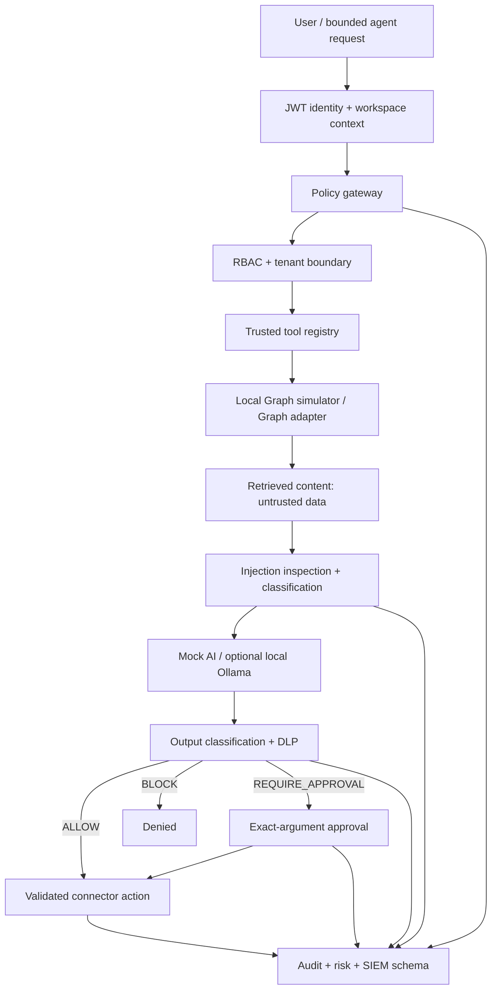

# Secure AI Governance Platform

A local-first, portfolio-grade reference implementation for governing bounded AI agents in an
enterprise security context. The platform demonstrates server-enforced identity, tenant isolation,
RBAC, data classification, DLP, prompt-injection containment, exact-action human approvals,
behavioral risk signals, structured audit events, and SIEM-ready output.

> **Accuracy statement:** this repository does not claim live cloud AI, Microsoft, Azure, SIEM,
> or production integrations. The default runtime uses deterministic local simulators and
> synthetic data.

## 1. Project overview

The application exposes a FastAPI policy gateway and a Next.js governance console. Its core demo
handles: “Summarize these customer documents and email the summary to an external recipient.” The
model cannot call connectors directly. Application code performs every authorization, policy,
approval, and argument check.

## 2. Business problem

Enterprise AI assistants can become confused deputies: they combine a user's identity, retrieved
content, powerful connectors, and probabilistic output. Without a policy enforcement point, an
indirect prompt injection or overprivileged tool can turn ordinary summarization into data
exfiltration. This project makes the trust boundaries and decision evidence explicit.

## 3. Architecture



Detailed ownership and request sequence: [docs/architecture.md](docs/architecture.md).

## 4. Security model

- JWT claims carry user, role, and workspace; the server rechecks resource workspace ownership.
- A static tool allowlist maps roles to tools. Unknown tools are denied.
- Retrieved text remains untrusted data and is scrubbed of instruction-like content before summary.
- DLP is deterministic ordered code, not a model prompt.
- Writes run final argument validation and output inspection immediately before connector execution.
- Approvals expire, are single-use, tenant-bound, and HMAC-bound to canonical action arguments.
- Audit events record entity types and decisions, not raw sensitive payloads.
- Semantic cache keys include workspace, user, authorization context, and normalized prompt.

See [docs/security.md](docs/security.md) and [docs/threat-model.md](docs/threat-model.md).

## 5. Threat model

The threat model covers direct and indirect prompt injection, exfiltration, confused deputy,
excessive agency, cross-tenant access, privilege escalation, malicious tool arguments, approval
replay, cache leakage, credentials, logging, and insider abuse. Each entry maps scenario, impact,
mitigation, and regression proof in [docs/threat-model.md](docs/threat-model.md).

## 6. Features

- Local identity provider, PBKDF2 password verification, signed JWTs, four roles, workspace tenancy
- Entra-style provider contract and documented OIDC integration seam
- Regex/rule-based PII, SSN, card-like, secret, API-key, customer-ID, and financial classification
- Local Information Protection-style sensitivity labels
- Ordered DLP decisions: `ALLOW`, `BLOCK`, `REDACT`, `REQUIRE_APPROVAL`
- Layered prompt-injection detection and retrieved-document trust boundary
- Eight bounded tools with role checks and named-query database allowlisting
- Immutable approval records with exact-argument HMAC digests
- Insider-risk style explainable behavioral rules
- Local Graph files/email plus a fail-closed Microsoft Graph adapter seam
- Authorization-scoped expiring cache with sensitive-response bypass
- Alembic-managed PostgreSQL approval/audit persistence with atomic approval consumption
- Tenant-filtered pgvector retrieval with deterministic local or optional Ollama embeddings
- Optional Keycloak OIDC, OPA policy, Presidio analysis, and OpenSearch event adapters
- Measured adversarial prompt corpus runner and policy-as-code regression tests
- Prometheus endpoint, request IDs, structured JSON logging, audit schema, and SIEM examples
- Enterprise Next.js console across workspace, documents, classification, DLP, approvals, risk,
  audit, security events, and integration settings

## 7. Tech stack

- Python 3.12, FastAPI, Pydantic v2, SQLAlchemy 2, PyJWT, structlog, Prometheus client
- PostgreSQL 17 with pgvector in Compose; SQLite-compatible security-state persistence for tests
- Next.js 16, React 19, TypeScript 5, CSS without a component framework
- pytest, Ruff, mypy, Bandit, ESLint, npm audit, CodeQL, Dependabot, Gitleaks, Semgrep, Trivy
- Optional local Ollama adapter; deterministic mock AI is the default

## 8. Local setup

Prerequisites: Python 3.12, Node.js 22, npm, and optionally Docker.

```bash
git clone <your-repository-url>
cd secure-ai-governance-platform
python3.12 -m venv .venv
source .venv/bin/activate
pip install -e '.[dev]'
cp .env.example .env
uvicorn apps.api.governance.main:app --reload --port 8000
```

In a second terminal:

```bash
cd apps/web
npm ci
NEXT_PUBLIC_API_URL=http://localhost:8000 npm run dev
```

Open `http://localhost:3000`. Synthetic demo analyst credentials are prefilled on the login page.
For a one-command container demo:

```bash
docker compose up --build
```

The base stack keeps local JWT, policy/classification, and mock AI while enabling durable
PostgreSQL state and pgvector retrieval. To run the optional free enterprise lab services:

```bash
docker compose -f docker-compose.yml -f docker-compose.enterprise.yml up --build
```

That overlay starts Keycloak, OPA, Presidio Analyzer, OpenSearch, and OpenSearch Dashboards. It is a
local integration lab, not a production deployment. See [docs/enterprise-stack.md](docs/enterprise-stack.md).

## 9. Demo walkthrough

1. Sign in as the synthetic analyst.
2. Select **Public Product Brief** and an internal `@example.corp` recipient: the action is allowed.
3. Select **Synthetic Customer Contract** and an external recipient: `DLP-EXT-002` requests approval.
4. Select **Synthetic Employee Record** and an external recipient: `DLP-EXT-001` blocks the action.
5. Select **Untrusted Supplier Note**: injection text is removed from the model input and a
   `prompt_injection_detected` event appears.
6. Review exact rule IDs and tool trace in the workspace, then inspect Audit and Security Events.

Suggested GitHub screenshots: login trust statement; workspace blocked decision and tool trace;
confidential pending approval; classification entities; risk explanation; audit event table;
integration status cards.

## 10. Testing

```bash
.venv/bin/ruff format --check apps tests
.venv/bin/ruff check apps tests
.venv/bin/mypy apps/api/governance
.venv/bin/alembic upgrade head
.venv/bin/pytest --cov=apps.api.governance
.venv/bin/bandit -r apps/api/governance -x tests
.venv/bin/python scripts/run_security_evals.py
docker run --rm -v "$PWD/policies:/policies:ro" openpolicyagent/opa:1.10.1 test /policies
cd apps/web
npm run lint
npm run typecheck
npm run build
npm audit --audit-level=high
```

The suite contains meaningful security regressions for tenant isolation, normal retrieval, sensitive
sharing, approval replay/mutation/expiry, prompt injection, tool allowlisting, secrets, cache
isolation, deterministic DLP, audit evidence, and behavioral risk signals.

## 11. Data classification

Levels are `PUBLIC`, `INTERNAL`, `CONFIDENTIAL`, and `HIGHLY_CONFIDENTIAL`. Labels are local
Information Protection-style labels: Public, Internal, Confidential, Highly Confidential, and
Restricted External Sharing. Entity values are masked in classification results. See
[docs/dlp.md](docs/dlp.md).

## 12. DLP design

Policies are ordered, deterministic, and return the policy ID, matching rule, reason, affected entity
types, and decision. Secret blocking precedes sharing rules; highly confidential external sharing is
blocked; high-risk PII can be redacted; confidential external sharing requires approval. The sample
machine-readable policy set is in [examples/policies/dlp-policies.json](examples/policies/dlp-policies.json).

## 13. Agent security

The “agent loop” is deliberately bounded. User intent selects a predefined workflow; a model never
invents or executes a tool. Read tools can run only after RBAC and tenant checks. Connector writes
require schema validation, DLP, authorization, and when required an approved argument digest. The
final body is reclassified immediately before sending.

## 14. Human approvals

Approval state contains no mutable action payload. It stores an HMAC digest of canonical JSON,
workspace, requester, action, status, and expiration. Consumption uses constant-time digest
comparison and atomically moves an approved record to consumed. Changing recipient, body, subject,
source IDs, action, or tenant invalidates it.

## 15. Insider-risk analytics

This is **insider-risk style behavioral analytics**, not Microsoft Insider Risk Management. Local
rules score bulk document access, repeated blocked exports, repeated external shares, failed
authorization, sensitive enumeration, privilege-sensitive actions, and unusual UTC access time.
Scores are derived from observed counters and list every contributing signal; the UI contains no
fabricated metric.

## 16. Audit and SIEM

Sensitive actions emit a normalized JSON schema containing event/request IDs, timestamp, identity,
workspace, action/tool/resource, classification, policy decision/ID, approval ID, result, risk score,
reason, and event type. Raw document or email bodies are excluded. A sample event and Azure-style
workflow envelope live under `examples/`. An optional OpenSearch adapter indexes an allowlist of
event metadata; no SIEM is connected by default. Other SIEM adapters remain future work.

## 17. Microsoft integration architecture

`LocalGraphSimulator` is active by default. `MicrosoftGraphProvider` reads the standard Azure app
environment variables and fails closed when absent; its live HTTP operations remain intentionally
disabled until tenant consent, scope review, and credential configuration are supplied.
`MicrosoftEntraProvider` is an OIDC seam and does not accept passwords. See
[docs/microsoft-integrations.md](docs/microsoft-integrations.md).

The phrases “Purview-style classification and DLP simulation” and “Entra-style identity provider”
describe local concepts only. They are not product integration claims.

## 18. Implemented vs Simulated vs Integration-Ready

| Status | Capabilities |
|---|---|
| Implemented | Local identity/JWT/RBAC, OIDC/JWKS validation, tenant checks, classification, DLP, injection defenses, bounded tools, durable approvals/audit, SIEM schema, risk rules, scoped cache, tenant-safe vector retrieval, API, UI, metrics, tests |
| Simulated | M365-like documents and mail, synthetic identities/data, behavioral event history, deterministic model summaries, hash embeddings |
| Integration-ready | Microsoft Graph interface, Entra OIDC architecture, Ollama adapter, Azure Function/Logic App payloads, Keycloak/OPA/Presidio/OpenSearch local lab |
| Not implemented | Live Purview, live Entra/Graph/M365, Copilot Studio, Azure AI Foundry, live Azure workflows, external cloud model calls, production SIEM ingestion |

## 19. Limitations and production hardening

- Risk counters and cache remain single-process demo state; approvals/audit are durable when
  `PERSISTENCE_MODE=database` (the Compose default).
- Local demo credentials are public synthetic fixtures and must not be used in a deployment.
- Regex classification has expected false positives/negatives and needs governed detectors.
- Local JWT uses a symmetric secret; optional OIDC mode validates RS256 signatures, issuer,
  audience, expiry, roles, workspace context, and rotating JWKS.
- Connector calls need workload identity, least-privilege consent, retry/idempotency, and egress policy.
- Approval persistence uses atomic status transitions; production still needs explicit
  separation-of-duties policy, database authorization, and high-availability testing.
- Audit storage needs append-only controls, retention, access review, integrity, and delivery guarantees.
- Behavioral thresholds need baselining, privacy review, case management, and false-positive handling.
- Secrets need a managed vault; TLS, rate limiting, CSRF strategy, CSP, WAF, backups, and disaster
  recovery are deployment responsibilities.
- OpenSearch forwarding is synchronous and needs a durable queue, retry/dead-letter handling,
  authentication, and TLS before production use.
- Local hash embeddings are deterministic test vectors, not a claim of semantic quality.

## 20. Roadmap

1. Persist risk state and add a Redis cache with envelope encryption and authorization invalidation.
2. Complete a consent-reviewed Microsoft Graph implementation against a dedicated test tenant.
3. Add policy bundle signing, version approval, simulation, and rollback governance.
4. Add queued SIEM delivery with authentication, retry/dead-letter behavior, and tracing.
5. Expand adversarial coverage and report only reproducible evaluator/classifier measurements.

## Portfolio skill mapping

See [docs/skill-mapping.md](docs/skill-mapping.md) for evidence mapped to secure agentic AI,
governance, Microsoft concepts, PowerShell, Azure, SIEM/XDR, Python, TypeScript, API security, and
DevSecOps—with implementation status stated explicitly.
